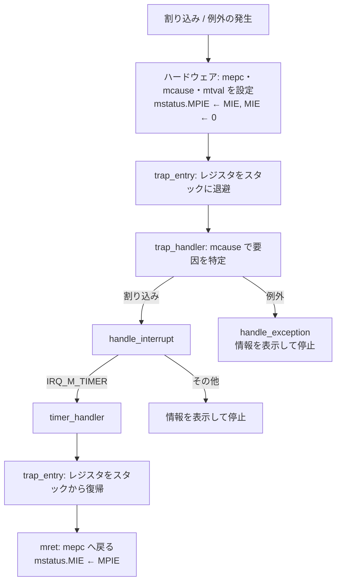

# 割り込みハンドラ仕様

この文書は、RV32I / QEMU virt 上のトラップ（割り込み・例外）処理の仕様を記述する。

## 1. 前提と対象範囲

| 項目 | 内容 |
|---|---|
| 対象マシン | QEMU `virt`（`-bios none`） |
| 動作モード | マシンモード（M-mode）のみ。S-mode / U-mode は使わない |
| 対象 hart | hart 0 のみ |
| トラップベクタ | `mtvec` の Direct モード（全トラップが `trap_entry` に入る） |
| 有効な割り込み | マシンタイマ割り込み（MTI）のみ |
| 多重割り込み | なし（ハンドラ実行中は割り込み禁止） |

CSR の番号、ビット定義、アクセスマクロは、riscv-opcodes から生成した `third_party/riscv-opcodes/encoding.h` を使う。

## 2. 関連ファイル

| ファイル | 役割 |
|---|---|
| `src/start.S` | `mtvec` に `trap_entry` を設定する |
| `src/trap.S` | トラップの入口。レジスタの退避と復帰、`mret` |
| `src/trap.h` | トラップフレーム `struct trap_frame` の定義 |
| `src/trap.c` | 要因の特定と、割り込み処理・例外処理への振り分け |
| `src/timer.c` / `src/timer.h` | CLINT を使った周期タイマと、タイマ割り込みの処理 |
| `src/main.c` | タイマの初期化、割り込みの全体許可、tick の表示 |

## 3. 初期化シーケンス

1. `_start`（`src/start.S`）が `mtvec` に `trap_entry` のアドレスを書く。
   - Direct モードでは `mtvec` の下位 2 ビットが 0 である必要があるので、`trap_entry` は `.align 2`（4 バイト境界）で配置する。
2. `main` が `timer_init(TIMER_FREQ_HZ)` を呼ぶ。
   - `mtimecmp` に「現在の `mtime` + 周期」を書く。
   - `mie.MTIE` を 1 にする（タイマ割り込みの個別許可）。
3. `main` が `mstatus.MIE` を 1 にする（割り込みの全体許可）。

手順 3 の後で `mtime >= mtimecmp` になると、タイマ割り込みが発生する。

## 4. トラップ処理の流れ



### 4.1 ハードウェアの動作（トラップ発生時）

| CSR | 設定される値 |
|---|---|
| `mepc` | 割り込まれた命令、または例外を起こした命令のアドレス |
| `mcause` | 要因（最上位ビットが割り込み / 例外の区別、残りが要因コード） |
| `mtval` | 例外の付加情報（不正アドレスなど） |
| `mstatus.MPIE` | トラップ前の `mstatus.MIE` |
| `mstatus.MIE` | 0（以降の割り込みを禁止） |

この後、PC は `mtvec` の値（`trap_entry`）になる。

### 4.2 レジスタの退避（`trap_entry` 前半）

1. `sp` を `FRAME_SIZE`（144 バイト）減らして、トラップフレームを確保する。
2. x1、x3〜x31 をフレームに保存する。
3. トラップ前の `sp`（現在の `sp` + 144）を計算して、x2 の位置に保存する。
4. `mepc` と `mstatus` をフレームに保存する。

### 4.3 C ハンドラの呼び出し

`a0` にフレームの先頭アドレスを入れて、`trap_handler(struct trap_frame* tf)` を呼ぶ。

### 4.4 レジスタの復帰（`trap_entry` 後半）

1. フレームの `mepc` と `mstatus` を CSR に書き戻す。
2. x1、x3〜x31 をフレームから読み戻す。
3. `sp` に 144 を足して、フレームを解放する。
4. `mret` を実行する。
   - PC ← `mepc`
   - `mstatus.MIE` ← `mstatus.MPIE`（割り込み許可状態がトラップ前に戻る）

`mepc` と `mstatus` は CSR の値ではなくフレームの値を書き戻す。そのため、C ハンドラで `tf->mepc` を書き換えると、戻り先を変えられる。

## 5. トラップフレーム

`trap.S` がスタック上に作るレジスタ退避領域。レイアウトは `src/trap.h` の `struct trap_frame` と一致させる。

| オフセット | フィールド | 内容 |
|---|---|---|
| 0 | `regs[0]` | 未使用（x0 は常に 0 なので保存しない。値は不定） |
| 4 | `regs[1]` | x1 (ra) |
| 8 | `regs[2]` | x2 (sp)。トラップ前の値 |
| 12 – 124 | `regs[3]` – `regs[31]` | x3 – x31（`regs[i]` が x(i) に対応） |
| 128 | `mepc` | トラップ時の `mepc` |
| 132 | `mstatus` | トラップ時の `mstatus` |
| 136 – 143 | （パディング） | 未使用 |

- 必要なサイズは 136 バイト。ABI の要求（`sp` は 16 バイト境界）に合わせて 144 バイトに切り上げる。
- 退避先は、割り込まれたコードが使っていたスタック。トラップ専用のスタックは持たない。

### 5.1 全レジスタを退避する理由

割り込みから同じ場所に戻るだけなら、caller-saved レジスタ（ra、t0〜t6、a0〜a7）の退避で足りる。callee-saved レジスタ（s0〜s11）は、呼び出し規約によって C ハンドラ側で保存・復元されるからである。

この実装では、プリエンプティブなタスク切り替え（ロードマップのステップ 3）に備えて、x1〜x31 をすべて退避する。

- タイマ割り込みでタスクを切り替える場合、復帰処理の前に `sp` を別タスクのフレームに差し替える。
- 切り替え先のタスクの s0〜s11 も、そのタスクのフレームから戻す必要がある。
- フレームが CPU 状態をすべて持つので、タスク切り替えは「`sp` の差し替え + 同じ復帰処理」で実現できる。

## 6. 要因の特定

`trap_handler` は `mcause` を読み、次のように振り分ける。

| 判定 | 式 | 振り分け先 |
|---|---|---|
| 割り込みか例外か | `mcause & MCAUSE_INT`（最上位ビット） | 1 → `handle_interrupt`、0 → `handle_exception` |
| 要因コード | `mcause & MCAUSE_EXCCODE`（下位 31 ビット） | 振り分け先に渡す |

### 6.1 割り込み（`handle_interrupt`）

| 要因コード | 名前 | 処理 |
|---|---|---|
| 7 | `IRQ_M_TIMER`（マシンタイマ） | `timer_handler()` を呼ぶ |
| その他 | — | `UNKNOWN INTERRUPT code=<要因コード>` を UART に出力して停止する |

マシンソフトウェア割り込み（3）とマシン外部割り込み（11）は、`mie` で許可していないので発生しない。

### 6.2 例外（`handle_exception`）

例外からの回復処理はない。次の情報を UART に 16 進 8 桁で出力して、無限ループで停止する。

```
EXCEPTION
mcause=<要因コード>
mepc=<フレームの mepc>
mtval=<mtval CSR の値>
```

`ecall` などの例外から処理を続ける場合は、`tf->mepc` に 4 を足して次の命令に戻す必要がある。この処理はまだない。

## 7. タイマ割り込み

### 7.1 CLINT レジスタ（hart 0）

| レジスタ | アドレス | 内容 |
|---|---|---|
| `mtimecmp` | `0x0200_4000`（下位）、`0x0200_4004`（上位） | `mtime >= mtimecmp` でタイマ割り込みが発生する |
| `mtime` | `0x0200_BFF8`（下位）、`0x0200_BFFC`（上位） | 一定の周期で増える 64 ビットカウンタ |

- `mtime` は 10 MHz で増える（`TIMER_FREQ_HZ = 10000000`）。
- `main` は周期に `TIMER_FREQ_HZ` を渡すので、割り込みは 1 秒ごとに発生する。

### 7.2 64 ビットレジスタへのアクセス

RV32 は 64 ビットを 1 回で読み書きできないので、上位と下位の 32 ビットに分けてアクセスする。

- **`mtime` の読み出し**: 上位 → 下位 → 上位の順に読む。2 回の上位が一致しないとき（下位を読む間に桁上がりがあったとき）は、読み直す。
- **`mtimecmp` の書き込み**: 上位に `0xFFFFFFFF` → 下位 → 上位の順に書く。書き込み途中の値で割り込みが発生することを防ぐ。

### 7.3 `timer_handler` の処理

1. `ticks` を 1 増やす。
2. `next_compare` に周期を足して、`mtimecmp` に書く。
   - `mtimecmp` を更新すると、割り込み要因（`mip.MTIP`）が解除される。
   - 次の時刻は「前回の設定値 + 周期」で計算する。「現在の `mtime` + 周期」で計算すると、ハンドラに入るまでの遅れが周期に加わって、ずれが蓄積するからである。

### 7.4 メイン処理との分担

- 割り込みハンドラは `ticks` を増やすだけにする。UART への出力はしない。
- `ticks` は割り込みハンドラと `main` で共有するので、`volatile` にする。
- `main` は `wfi` で割り込みを待ち、`timer_get_ticks()` の値が変わったら `tick <値>` を 16 進で出力する。

実行時の出力:

```
BSS OK
tick 00000001
tick 00000002
tick 00000003
```

## 8. 制約

- **多重割り込みなし**: ハンドラ実行中は `mstatus.MIE` が 0 なので、次の割り込みは `mret` の後に受け付ける。
- **未知の割り込みと例外は停止**: 情報を出力して無限ループに入る。システムは処理を続けない。
- **スタックの使用量**: トラップ 1 回につき、フレームの 144 バイトと C ハンドラが使う分を、割り込まれたコードのスタックから使う。
- **単一 hart**: CLINT のアドレスは hart 0 の値に固定している。
